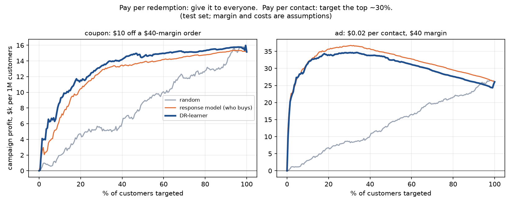
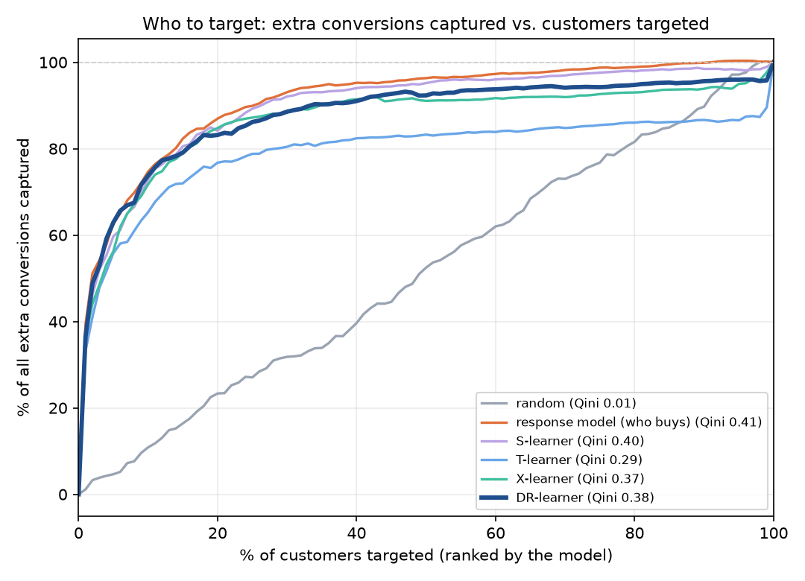

# uplift-targeting

Who should get the incentive? An uplift-modelling study on Criteo's 14-million-user randomized experiment: which customers buy *because of* the ad or coupon, which would buy anyway, and when targeting actually makes money.

Short version: targeting matters a lot (the right 10% of customers hold about three-quarters of the extra conversions), but on this data the plain "who is likely to buy" model ranks customers as well as dedicated uplift models, and whether targeting pays depends on how you pay for the incentive. Per contact, target the top ~30% (+40% profit). Per redemption, give it to everyone.



## Results

Criteo Uplift Prediction dataset v2.1: 13,979,592 users, 85% randomly assigned to the incentive (ad eligibility), outcomes `visit` and `conversion`, 12 anonymised features. Split 60/20/20 (train / early stopping / test), stratified on treatment and outcome. Every number below is on the 2,795,920 test users; intervals are 95% bootstrap intervals.

**The incentive works on average.** Conversion rate 0.309% treated vs 0.194% control (+59%); visits +27%. Treatment and control are balanced: no feature differs by more than 0.05 standard deviations. Note that Criteo sub-sampled this data non-uniformly for privacy, so absolute rates and the overall lift describe this dataset, not the original campaign.

**Most treated conversions would have happened anyway:** 63% of conversions in the treated group occur at the control group's rate. A blanket coupon pays a discount on every one of them.

**Who to target** (share of all extra conversions captured when treating the top-k customers by each model):

| Ranking | Top 10% | Top 20% | Top 30% | Qini coefficient |
| --- | --- | --- | --- | --- |
| random | 11% | 23% | 32% | 0.01 [-0.02, 0.05] |
| **response model** (P(convert), ignores treatment) | **75%** [69, 81] | **87%** | **93%** | **0.41** [0.40, 0.43] |
| S-learner | 73% [66, 78] | 84% | 92% | 0.40 [0.36, 0.42] |
| DR-learner (primary, fixed in advance) | 74% [67, 80] | 83% | 89% | 0.38 [0.34, 0.42] |
| X-learner | 72% [67, 78] | 85% | 88% | 0.37 [0.34, 0.41] |
| T-learner | 65% [58, 72] | 77% | 80% | 0.29 [0.24, 0.34] |

On visits the uplift learners do beat the response model early (top 10%: S-learner 65% [62, 70] vs response 53% [49, 56]), and the Qini coefficients are 0.38 (S, DR) vs 0.35 (response). Full tables: `results/summary.json`.



**Why the response model holds up on conversions.** Conversions are extremely concentrated: the top decile by P(convert) converts at 2.7% treated, every other decile at 0.19% or less. Within that decile about 31% of treated conversions are extra, close to the 37% overall, so the incentive's effect scales roughly with how likely someone already was to buy. When uplift is roughly proportional to the baseline, ranking by "who buys" and ranking by "who is moved" pick the same people.

**Money** (per 1 million customers; margin and costs are assumptions, the targeting share is chosen on one random half of the test set and profit measured on the other half, over 20 splits):

| Cost model | Treat everyone | Best targeting | Gain [5th–95th pct] |
| --- | --- | --- | --- |
| Ad, $0.02 per contact, $40 margin | $26.1k | response model, top ~31%: **$36.4k** | **+$10.3k** [+9.3k, +11.0k] |
| | | S-learner, top ~29%: $36.0k | +$10.0k [+9.0k, +11.1k] |
| | | DR-learner, top ~28%: $34.2k | +$8.1k [+6.4k, +9.8k] |
| Coupon, $10 off a $40-margin order | $15.2k | no rule beats treating everyone | between −$0.7k and +$0.3k, all inside noise |
| Coupon, $5 off a $40-margin order | $30.6k | no rule beats treating everyone | between −$0.5k and +$0.1k, all inside noise |

With a per-redemption coupon the cost scales with the conversions a customer makes, and since the extra share of conversions is similar across segments, every segment is about equally profitable to treat. With a per-contact cost, the 70% of customers who almost never convert cost money and return almost nothing, so cutting them pays.

## Two traps this project fell into first

1. **Tied scores.** The DR-learner gives 41% of test users the same predicted uplift (regression on a rare outcome), and the Criteo file is stored sorted by treatment (the first quarter of rows is 100% treated). A stable sort therefore ordered tied users by file position, which bent the Qini curve and cut the DR-learner's Qini coefficient from 0.38 to 0.26. Every metric now breaks ties at random with a fixed seed, and `test_tied_scores_do_not_follow_file_order` guards it.
2. **Choosing the threshold on the test data.** Picking the profit-maximising share on the same rows that score it made the DR-learner look like the most profitable coupon policy and even let random targeting "gain" $648. With the share chosen on one half and scored on the other, the coupon gains disappear into noise.

## How it works

- `prepare_data.py` downloads the CSV from [Criteo's Hugging Face page](https://huggingface.co/datasets/criteo/criteo-uplift) and writes compact Parquet.
- `uplift.py` holds the learners (all LightGBM) and the evaluation:
  - **response**: P(y | x) ignoring treatment, the common baseline.
  - **S-learner**: one model with treatment as a feature.
  - **T-learner**: one model per arm, uplift = difference.
  - **X-learner** (Künzel et al., 2019): imputed individual effects regressed per arm and combined with the propensity.
  - **DR-learner** (Kennedy, 2020): doubly robust pseudo-outcome regressed on x.
  - X and DR use 2-fold cross-fitting. Evaluation relies only on randomization: within any slice of users, treated rate minus control rate estimates their uplift.
- `run_experiment.py OUTCOME` trains everything on 8.4M users and evaluates on the test set (~38 minutes per outcome on a 20-thread laptop CPU).
- `rescore.py` recomputes all metrics from saved predictions without retraining.
- `report.py` draws the charts and runs the money analysis.

The DR-learner was named the primary model before any test result was seen; the others are reported for comparison.

## Run it

```bash
python -m venv .venv
.venv/Scripts/python.exe -m pip install -r requirements.txt   # .venv/bin/python on Linux/macOS
python prepare_data.py
python run_experiment.py visit
python run_experiment.py conversion
python report.py
python -m pytest -q
```

## Limitations

- **Treatment is ad eligibility, not a coupon.** The coupon and ad scenarios apply the same measured uplift to two cost models; the margins and costs are illustrations, not Criteo's.
- **Non-uniform sub-sampling.** Criteo sub-sampled the data so the original incrementality cannot be recovered, so absolute rates and dollar figures are for this dataset.
- **Anonymised, randomly projected features.** There is no way to say *which* customers respond in business terms.
- **One dataset.** The finding that a response model is as good as uplift models depends on uplift scaling with the baseline here. On data where incentives move a different group from the likely buyers, uplift models should win clearly.
- **Hyperparameters were not tuned per learner.** All learners share one LightGBM configuration with early stopping.

## Data and credits

Data: Criteo Uplift Prediction Dataset v2.1, CC BY-NC-SA 4.0, not redistributed here. E. Diemert, A. Betlei, C. Renaudin, M.-R. Amini. *A Large Scale Benchmark for Uplift Modeling.* AdKDD 2018 workshop at KDD. (The dataset card's "25M rows" describes an earlier version; v2.1 has 13,979,592.)

Code: MIT.
